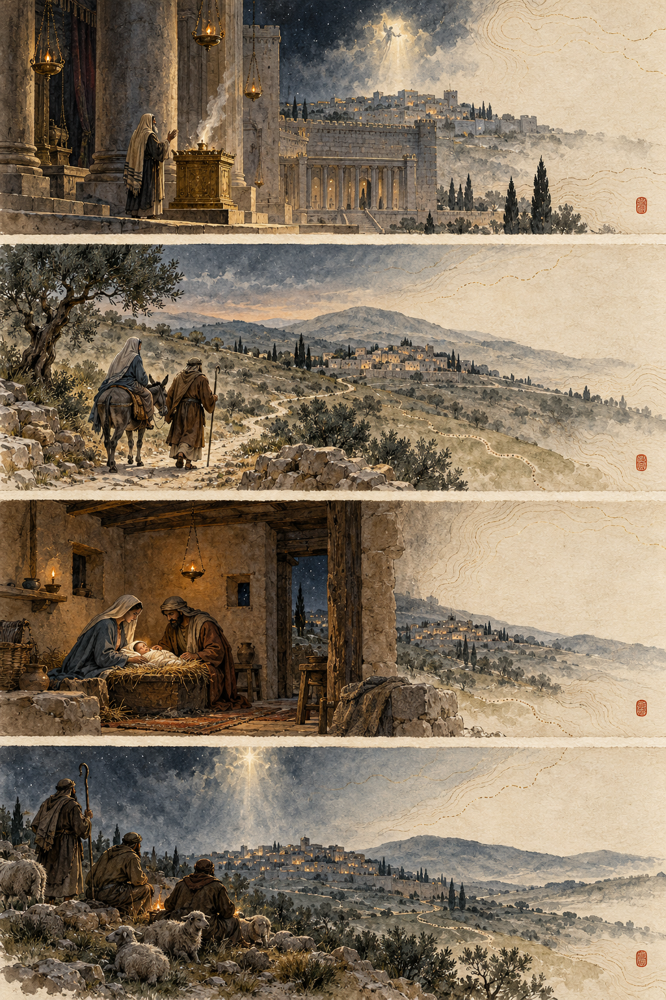

# Ink storyboard: The birth of Jesus

This is a first visual study for a scroll-driven iPhone sequence. The image is a mood and composition sample, not final app artwork.

## Story movements

| Movement | Existing scenes | Visual transition | Meaning and evidence cues |
| --- | --- | --- | --- |
| Promise | `zechariah`, `annunciation`, `visitation` | A temple lamp becomes a fine line through the Judean hills, reaching Nazareth and the hill country. | Begin with waiting and promise. Anchor named locations to the reviewed local map geometry. |
| Decree and journey | `decree`, `journey` | Pull back to Rome and the empire, then return toward Bethlehem as a dry-brush route appears. | Set imperial scale beside an ordinary family journey. Luke does not specify a precise road, so keep the route schematic. |
| Birth and witness | `birth`, `shepherds`, `present` | Ink settles into a warm home interior, opens into night fields, then carries light toward Jerusalem's Temple. | Avoid asserting a freestanding stable. Keep the shepherds' exact field location uncertain. |
| Visitors and refuge | `magi`, `egypt`, `nazareth` | Gold flecks approach from the east; a dark wash follows the family's flight; the palette clears on their return to Nazareth. | Matthew says the Magi came from the east without naming their origin. Keep their approach and the flight route illustrative. |

## Interaction

- Map scroll progress to scene anchors, ink reveal, camera movement, route drawing, and title/verse fades.
- Preserve reverse scrolling, chapter jumps, saved-scene links, tappable map points, and native Scripture controls.
- Keep route and location uncertainty visible in the painting as well as the map legend.
- Respect Reduce Motion with static compositions and simple crossfades.

## First implementation slice

Start with `journey` → `birth` → `shepherds`. This exercises the route reveal, domestic interior, night-field transition, text placement, and uncertainty treatment. Use local map data, image masks, and SwiftUI Canvas so the effect works offline and does not need runtime video or a map service.

Reference workflow: [scroll-driven ink painting post](https://www.reddit.com/r/claudeskills/comments/1xcimzw/how_to_make_a_scrolldriven_ink_painting_website/).
